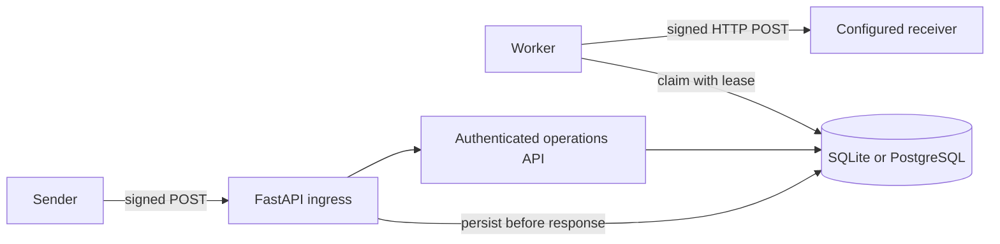

# RelayQueue

[](https://github.com/Mzulhaq/relayqueue/actions/workflows/ci.yml)

RelayQueue accepts signed JSON webhooks, stores them before acknowledging, and delivers them from a separate worker with bounded retries. It is a compact Python backend project focused on durable delivery, request authentication, and recovery behavior.

## How it works



The worker moves events through `pending`, `inflight`, `retry_wait`, `succeeded`, or `dead`. Conditional database updates and lease tokens prevent an expired worker from overwriting a newer claim. Delivery is **at least once**: a receiver should deduplicate by `Webhook-Id`, since a receiver may accept a request just before the worker crashes.

## Requirements and setup

Python 3.11 or newer is required. CI is configured for Python 3.11 and 3.13. From the repository root:

```powershell
python -m venv .venv
.\.venv\Scripts\Activate.ps1
pip install -r requirements.lock
pip install -e . --no-deps
```

On Linux or macOS, activate with `source .venv/bin/activate` after creating the virtual environment. `pip install -e . --no-deps` installs this project after the exact locked dependencies. Python does not automatically load `.env`; Docker Compose reads it. For local Python commands, set the `RQ_*` variables in your shell or use the SQLite defaults where appropriate.

## Self-contained demo

Run `python scripts/demo.py`. It starts a loopback API and receiver plus a separate worker process, using a temporary SQLite database and generated runtime secrets. It needs no external receiver or credentials. The verified scenario covers three unique events: one succeeds immediately, one succeeds after two 503 responses, and one reaches dead-letter status after three 503 responses. It also sends 25 duplicate requests and one invalid signature, with 7 delivery attempts. See [validation notes](docs/validation.md) for evidence and scope.

## Run the service

Set `RQ_DATABASE_URL`, `RQ_INGRESS_SECRET`, `RQ_DESTINATION_SECRET`, `RQ_ADMIN_TOKEN`, and `RQ_DESTINATION_URL`. Each secret must be distinct and contain at least 32 non-whitespace ASCII characters. The destination must use HTTPS; `RQ_ALLOW_INSECURE_HTTP=true` is intended only for local development. See [.env.example](.env.example) for the complete configuration names.

For local Python processes, set variables in the shell. Replace each example secret with a separate randomly generated value (for example, `python -c "import secrets; print(secrets.token_urlsafe(32))"`). PowerShell:

```powershell
$env:RQ_DATABASE_URL = "sqlite:///./relayqueue.db"
$env:RQ_INGRESS_SECRET = "<distinct-random-secret>"
$env:RQ_DESTINATION_SECRET = "<distinct-random-secret>"
$env:RQ_ADMIN_TOKEN = "<distinct-random-token>"
$env:RQ_DESTINATION_URL = "https://your-receiver.example/webhook"
```

Bash:

```bash
export RQ_DATABASE_URL='sqlite:///./relayqueue.db'
export RQ_INGRESS_SECRET='<distinct-random-secret>'
export RQ_DESTINATION_SECRET='<distinct-random-secret>'
export RQ_ADMIN_TOKEN='<distinct-random-token>'
export RQ_DESTINATION_URL='https://your-receiver.example/webhook'
```

Start the API and worker in separate terminals. Initialize the API first so it creates the database schema:

```bash
uvicorn relayqueue.api:create_app --factory --host 127.0.0.1 --port 8000
relayqueue-worker
```

`/health` is a liveness endpoint and `/ready` checks database connectivity. `POST /webhooks` accepts an envelope with a `topic` and object-valued `data`. Required headers are `Webhook-Id`, `Webhook-Timestamp` (Unix seconds), and `Webhook-Signature` (`v1=<hex>`). The signature is HMAC-SHA256 over the timestamp, a period, event ID, a period, and the exact raw request bytes. Timestamps are accepted within five minutes. Retries are signed with a fresh timestamp.

New events receive `202`; identical bytes under an existing ID receive `200`; reusing an ID with different bytes receives `409`. Invalid signatures receive `401`, invalid IDs `400`, oversized bodies `413`, wrong content type `415`, and invalid JSON/envelopes `422`. The body limit is 65,536 bytes. Event history (`GET /events`, `GET /events/{id}`) and JSON counters (`GET /metrics`) require `Authorization: Bearer <RQ_ADMIN_TOKEN>`.

The single configured receiver is shared by the service; per-request destinations and multi-tenant routing are not supported. Network errors, 408, 425, 429, and 5xx responses are retried with bounded exponential backoff. Other non-2xx responses are terminal. Redirects are disabled, and response bodies are not retained.

## Development checks

```bash
pytest --cov=relayqueue
ruff check .
ruff format --check .
python -m build
```

SQLite supports the local demo. PostgreSQL integration tests use `TEST_DATABASE_URL`; point it only at a dedicated test database because the test fixture drops its tables. Production runtime configuration uses `RQ_DATABASE_URL`.

Docker Compose starts PostgreSQL 17, schema initialization, API, and worker services. Provide a valid HTTPS receiver URL in `.env` before starting it; Compose does not include an always-on receiver. The database uses a named volume.

```bash
cp .env.example .env # On PowerShell: Copy-Item .env.example .env
# Edit .env: generate three independent secrets and set your receiver URL.
docker compose up --build -d
```

The Compose database uses a fixed local-demo password and is not exposed on a host port. Use separate credentials and deployment configuration for a real service. Set the same `RQ_*` variables in both terminals when running the Python API and worker directly.

## Scope and limitations

The project does not yet include schema migrations, retention, tenant quotas, rate limiting, retry jitter, or `Retry-After` handling. SQLite is suited to the local demonstration and small-scale use. Public deployment needs operational hardening, including TLS termination, secret management, access controls, and proxy configuration. No throughput or production-readiness claim is made. See [interview notes](docs/interview.md) and [career fit](docs/career-fit.md) for discussion and portfolio guidance.

This project was created with AI assistance. The code, tests, design tradeoffs, and hands-on exercise are available for inspection and learning.
